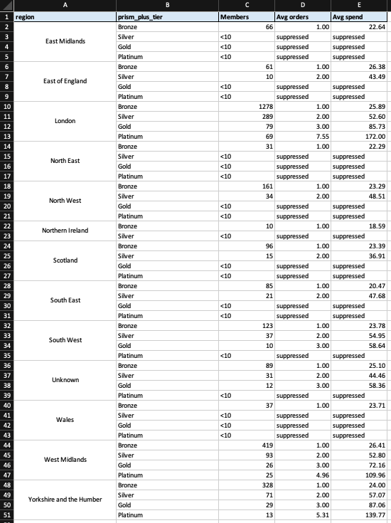
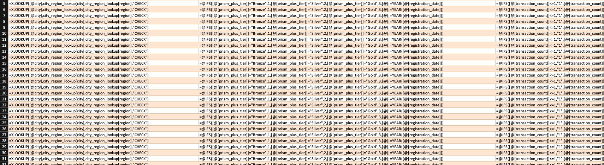

# GDPR data sharing assessment: can a retailer share its loyalty data?

**A retailer wanted to give its loyalty-scheme member file to a marketing partner. I tested how identifiable the 3,757 members were in Excel: 537 could be singled out. Our team recommended sharing a region-by-tier summary only, with every group under 10 hidden.**

| | |
|---|---|
| **My role** | Data lead in a team of 4. I built the Excel workbook and presented the evidence to over 40 people |
| **Skills** | Excel (XLOOKUP, IFS, PivotTables), re-identification testing, small-cell suppression, UK GDPR, ICO guidance |
| **Data** | 3,757 loyalty-scheme members, 12 columns |
| **Result** | "Yes, aggregated only": 50 region-by-tier cells, 20 hidden, with 6 conditions for the share |
| **Context** | Two-day team project, iO-Sphere data analyst placement, 19 and 20 November 2026 |

*The file we recommended sharing: members, average orders and average spend by region and tier. Every cell under 10 members shows `<10` and its averages are hidden.*

## Key findings

| Fields combined | Members alone in their group | Members in a group under 10 |
|---|---|---|
| City + tier + registration month | **537** | 1,626 |
| Region + tier + registration year | **12** | 178 |

- The file had no names or emails, but it was still personal data: 537 members could be singled out.
- Generalising cut that to 12, mostly Gold and Platinum members, so even a generalised member list was not safe.
- The sign-up box was already ticked and named no partner, so it was not valid consent to pass data on.
- **Recommendation: share the aggregate only.** 20 of 50 cells hidden (78 members, 2.1%), no IDs, cities, dates or grand totals. Prism sends the campaign; the partner never gets a member list.

## How I built it

<b>Checks and exclusions</b>

- No duplicate member IDs (0 of 3,757); every member opted in.
- Added each member's region with XLOOKUP from a city-to-region table, with `"CHECK"` as the fallback. No missing cities, no `#N/A`.
- Excluded 31 members we could not explain, with a log:

| Excluded | Members | Why |
|---|---|---|
| Outside the UK (Dublin, Frankfurt, Ashburn) | 26 | No use to a UK campaign, no UK region, tiny groups |
| Tier breaks the purchase rule | 5 | 3 Bronze members with no purchases, 2 whose tier did not match their order count |

3,757 rows became 3,726.

<b>Generalising, banding and the aggregate</b>

- Registration year instead of the full date; order bands (1, 2 to 3, 4 to 9, 10+) and spend bands (under £25 to over £100) instead of exact figures.
- A PivotTable of members, average orders and average spend by region and tier: 50 cells across 13 regions.
- Every cell under 10 members replaced with `<10` and its averages hidden. Grand totals turned off, so a hidden cell cannot be worked out by subtraction.
- Pasted as values, then every member-level column removed.

All formulas: [`excel-formulas.md`](excel-formulas.md). The shared file: [`data/aggregate_region_by_tier.csv`](data/aggregate_region_by_tier.csv).

<b>The legal assessment (team)</b>

Teammates led the legal research; the conclusions were agreed as a team.

**Consent.** We tested the pre-ticked box ("Yes, send me offers from Prism and our partners") against ICO guidance on valid consent:

| Condition | Verdict | Reason |
|---|---|---|
| Freely given | Arguable | It could be unticked, but only members who left it ticked could join the scheme |
| Specific | Fails | It covered offers in general, not this campaign |
| Informed | Fails | No partner was named |
| Unambiguous | Fails | A pre-ticked box is not a clear, positive action |

Sharing with a new partner is also a new purpose the members were never told about (UK GDPR Article 8A).

**Six conditions for a yes** (if any is missing, the answer is no):
1. A signed data sharing agreement: one campaign, no matching with the partner's data, no onward sharing, deletion within 30 days.
2. A DPIA: a short one now, a full one before any member-level share.
3. Every cell under 10 hidden, no grand totals.
4. Secure transfer only: encrypted file, password sent separately, no email attachments.
5. Prism sends the campaign; the partner never receives a member list.
6. Kept for the campaign only, at most 3 months.

**Top risks**

| Risk | Likelihood | Control |
|---|---|---|
| Members complain after the partner emails them | Low for an aggregate, high for a member list | Share the aggregate only; Prism sends the campaign |
| The partner tracks down members later | Medium | Agreement: no matching, no attempts to identify, deletion, audit rights |
| A lone Platinum member in one city is picked out | High before suppression, low after | Region only, hide cells under 10, no grand totals |

**Sources**, checked 19 and 20 November 2026: ICO guidance on consent, pseudonymisation, the data sharing code and high-risk processing; UK GDPR Articles 4, 5, 6, 8A, 13, 21, 28, 32 and 33 (legislation.gov.uk); GOV.UK guidance on copyright ownership.

<b>Limits</b>

- The re-identification counts were run on the full 3,757-member file, before the 31 exclusions.
- "Unknown" region (136 members) was kept as its own region; suppression hides its small cells.
- Band edges use "less than or equal to", so exactly £25 falls in "under £25".
- A training exercise, not legal advice. The DPIA was a screening, and no agreement was signed.

## About the data

The retailer, Prism, and its staff are fictional; a coach played the data protection officer. The member data is real retail data supplied for training. **No member-level data is in this repo**, only the suppressed aggregate.
